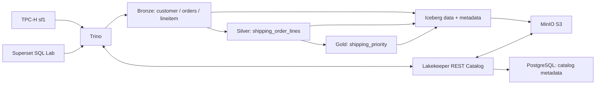

# Практическая работа №1: Lakehouse и TPC-H Q3

## 1. О проекте

Студент: **Потрикеев Андрей**. Вариант №1 — Q3 Shipping Priority, масштаб **sf1**. Конвейер материализует три слоя Iceberg в MinIO и выбирает десять заказов сегмента BUILDING: дата заказа раньше 15.03.1995, дата отгрузки позже 15.03.1995. Выручка — `sum(extendedprice * (1 - discount))`, без промежуточного округления.

Фактические результаты и ограничения запусков находятся в [report.md](report.md), исходные измерения — в [results](results). Наличие исходников само по себе не доказывает успешный запуск: успешность подтверждают JSON со статусом `passed` и совпадающим `run_id`.

## 2. Архитектура



## 3. Используемые технологии

| Технология | Версия | Роль и обоснование |
|---|---|---|
| MinIO | исходники RELEASE.2025-10-15T17-29-55Z | S3 API и разделение хранения/вычислений, в отличие от локальной FS |
| PostgreSQL | 16.8-alpine | Транзакционные метаданные Lakekeeper, не аналитические строки |
| Lakekeeper | 0.9.5 | Общий Iceberg REST Catalog вместо несвязанных файлов и ручного учёта таблиц |
| Iceberg | table spec v2 | Схема с ID колонок, снапшоты, согласованные изменения таблиц поверх файлов |
| Trino | 479 | SQL ELT, TPC-H connector и чтение Parquet/ORC через Iceberg |
| Superset | 4.1.2, trino driver 0.333.0 | SQL Lab и BI через тот же Trino; без копирования Bronze в BI |
| Python | контейнер 3.12.9, host 3.12+ | Оркестрация и измерения; runtime использует стандартную библиотеку |

MinIO и mc собираются локально из официальных закреплённых исходников: старые официальные registry images оказались недоступны при проверке. Сборка выполняется нативно для архитектуры Docker, без `platform: linux/amd64`. Инструкция сборки соответствует [официальному релизу MinIO](https://github.com/minio/minio/releases/tag/RELEASE.2025-10-15T17-29-55Z). Зависимости Go проверяются через Go checksum database. Сборочные слои не содержат `.env`. Команда `go install` оставляет в выводе бинарников `DEVELOPMENT.GOGET`; фактические исходные релизы закреплены в Dockerfiles, а зависимости проверяются Go checksum database.

Справочники конфигурации: [Lakekeeper 0.9 bootstrap](https://docs.lakekeeper.io/docs/0.9.x/bootstrap/), [пример Warehouse 0.9.5](https://github.com/lakekeeper/lakekeeper/blob/v0.9.5/examples/minimal/create-default-warehouse.json), [Trino 479 Iceberg](https://github.com/trinodb/trino/blob/479/docs/src/main/sphinx/connector/iceberg.md), [Trino 479 S3](https://github.com/trinodb/trino/blob/479/docs/src/main/sphinx/object-storage/file-system-s3.md).

Warehouse `local` использует bucket `lakehouse`, prefix `warehouse`, endpoint `http://minio:9000`, region `local-01`, path-style access. Trino обращается к `http://lakekeeper:8181/catalog`; статические S3 credentials подставляются через `${ENV:...}`. Vending отключён с обеих сторон; STS не нужен. Все компоненты используют внутренние Docker DNS имена. Наружу порты опубликованы только на loopback; это локальный учебный стенд без аутентификации Trino/Lakekeeper.

## 4. Требования к окружению

Docker Engine/Desktop, Compose v2+, make, Python 3.12+ на host. Для компьютера с 24 ГБ RAM достаточно выделить Docker 8–12 ГБ и 4 CPU; для первичной параллельной сборки предпочтительны 12 ГБ и 20 ГБ свободного диска. Trino: heap 3 ГБ, query memory 1500 MB, container limit 5 ГБ. Superset работает двумя gunicorn workers; его SQLite metadata живёт в отдельном volume, PostgreSQL выделен Lakekeeper. SQLite допустим для этой локальной однопользовательской демонстрации.

Первый запуск требует сети для загрузки образов, Python driver и Go modules; сборка MinIO занимает время. sf1 выбран как компромисс: три входные таблицы дают достаточно данных для сравнения колонночных форматов, но помещаются на локальной машине. Это не масштаб распределённого production Lakehouse.

## 5. Быстрый запуск

В корне проекта:

```bash
make env
make all
```

`make env` создаёт `.env` с уникальными паролями и правами 0600, существующий файл сохраняет. `.env.example` документирует переменные; его placeholder-значения не предназначены для запуска. Пароли можно посмотреть локально в `.env`, не публикуя его.

Полный цикл `make all` последовательно выполняет `up → bootstrap → pipeline → validate-rerun → iceberg → benchmark → metrics → bi → smoke → report`. При ошибке выполнение прекращается. Повторный `pipeline` пересоздаёт слои и инвалидирует старые артефакты; после него запускайте этапы проверки снова. Сам pipeline не транзакционен между таблицами: во время перестройки не запускайте потребителей.

Отдельные команды:

```bash
make up
make bootstrap
make pipeline
make validate-rerun
make iceberg
make benchmark
make metrics
make bi
make smoke
make report
make status
make logs
make down
```

| UI | Адрес | Доступ |
|---|---|---|
| Trino | http://localhost:8080 | user `lakehouse`, пароль не требуется |
| MinIO console | http://localhost:9001 | MINIO_ROOT_USER / MINIO_ROOT_PASSWORD из `.env` |
| MinIO S3 API | http://localhost:9000 | S3 credentials из `.env` |
| Lakekeeper | http://localhost:8181 | Management REST; Swagger UI зависит от сборки |
| Superset | http://localhost:8088 | SUPERSET_ADMIN_USER / SUPERSET_ADMIN_PASSWORD из `.env` |

SQL вручную:

```bash
docker compose exec trino trino --execute 'SELECT * FROM lakehouse.gold.shipping_priority ORDER BY revenue DESC LIMIT 10'
docker compose exec trino trino --execute 'SELECT * FROM lakehouse.bronze."lineitem$files"'
```

## 6. Структура данных

| Слой | Таблица | Колонки |
|---|---|---|
| Bronze | customer | custkey, mktsegment |
| Bronze | orders | orderkey, custkey, orderdate, shippriority |
| Bronze | lineitem | orderkey, extendedprice, discount, shipdate |
| Silver | shipping_order_lines | orderkey, orderdate, shippriority, shipdate, extendedprice, discount, line_revenue, mktsegment |
| Gold | shipping_priority | orderkey, revenue, orderdate, shippriority |

`customer.custkey → orders.custkey`, `orders.orderkey → lineitem.orderkey`. У customer и orders проверяется уникальность ключа. У проекции lineitem нет уникального `orderkey`: заказ имеет несколько корректных позиций, их нельзя удалять через DISTINCT. Iceberg не обеспечивает эти внешние ключи автоматически, их проверяет скрипт.

## 7. ELT pipeline

[sql/01_bronze.sql](sql/01_bronze.sql) сохраняет все строки sf1 с проекцией только нужных колонок; бизнес-фильтров нет. Это уменьшает хранение и перенос данных, позволяет connector projection pushdown без изменения выборки.

[sql/05_validation.sql](sql/05_validation.sql) проверяет NULL, ключи, сиротские ссылки, finite-цены и скидки в [0,1]. При нарушениях pipeline останавливается; корректные позиции не удаляются. Проверка нормализации показывает, меняет ли `upper(trim(mktsegment))` исходные строки. В проверенном sf1 нормализация не меняет ни одной строки. Она вычисляется в подзапросе customer перед фильтром BUILDING; поэтому строгая проверка неизменности Bronze гарантирует тот же результат, что и исходный Q3. Ошибочных строк не обнаружено, удаление данных не выполняется.

[sql/02_silver.sql](sql/02_silver.sql) выполняет JOIN, три фильтра и добавляет `line_revenue` с исходной floating point арифметикой, без CAST в DECIMAL и округления. [sql/03_gold.sql](sql/03_gold.sql) агрегирует Silver по заказу, затем выбирает топ-10. Физическая таблица не гарантирует порядок: каждый запрос просмотра сортирует Gold явно.

Все слои — Iceberg Parquet + ZSTD, свойства заданы в каждом CTAS. Таблицы не партиционированы: Q3 сканирует значительную часть сфокусированной проекции, Silver после фильтров меньше Bronze, а Gold содержит только десять строк. При sf1 дробление по месяцам может добавить мелкие файлы; преимуществ без отдельного эксперимента не заявляем.

## 8. Проверка правильности

`make validate` проверяет число строк и order-independent checksum проекций source/Bronze, типы (Iceberg снимает varchar length bound, сохраняя строковые значения), уникальность/ссылочную целостность, двусторонний `EXCEPT ALL` определения Silver и физической таблицы, суммы line_revenue до/после материализации, Q3 и физические S3 files.

Gold сравнивается по orderkey/orderdate/shippriority, revenue — `rel_tol=1e-10`, `abs_tol=1e-6`, что допускает шум распределённого суммирования DOUBLE и отвергает денежные изменения порядка цента на sf1. Порядок строк игнорируется. Если отличаются ключи около десятого места, дополнительно вычисляются агрегаты эталона: допускается только равенство на границе top-10, все строго большие суммы обязательны. Десять строк сами по себе не считаются доказательством.

`make validate-rerun` реально перестраивает pipeline второй раз и сравнивает fingerprints Bronze/Silver и Gold. `make smoke` требует пройденный rerun и артефакты всех обязательных этапов с единым `run_id`. JSON хранит выполненные SQL, query IDs и статистику. Bootstrap создаёт физическую probe-таблицу, читает значение 42 и проверяет S3 paths/размеры через `$files`.

Unit и статические проверки:

```bash
python3 -m venv .venv
.venv/bin/python -m pip install -r requirements.txt
make test
make static PYTHON=.venv/bin/python
```

Парсер SQL не исполняет connector procedures; `ALTER TABLE ... EXECUTE` проверяется живым этапом Iceberg. Unit-тест локального HTTP-протокола не заменяет тесты инфраструктуры.

## 9. Бенчмарк

`make benchmark`: Parquet/GZIP, Parquet/ZSTD, ORC/ZSTD, каждая конфигурация — три физические таблицы в `benchmark`, скопированные из Bronze с идентичными колонками/типами. Независимые экспериментальные копии изолируют формат и кодек, сохраняя основной Bronze и основной ELT без изменений. Бенчмарк не пересоздаёт основной Bronze. До измерений двусторонний `EXCEPT ALL` проверяет точное равенство bags. Для всех сценариев выполняется одна логика Q3, результат сопоставляется с исходным TPC-H.

По одному прогреву, по пять измерений, последовательно. Порядок конфигураций перемешивается с seed=1 в каждом повторении; фоновые ручные запросы следует исключить. Клиентский `perf_counter` включает HTTP и получение всех страниц. Сохранены сырые Trino stats (processedBytes — счётчик движка, не обещание физических S3 bytes), отдельные warmup, query IDs, медиана/min/max. Запись измеряется по каждой таблице и суммарно; это один замер записи, а не статистическая оценка её вариации. Время проверки равенства не входит во время записи/запроса. Все входные таблицы создаются до измеряемых серий.

Smoke дополнительно сверяет пути и размеры активных файлов со списком объектов MinIO через `mc ls --recursive --json` (S3 API), сохраняя evidence/minio-objects.ndjson.

Размер — сумма `file_size_in_bytes` активных data files (`content=0`) из Iceberg `$files`, в байтах и MiB (2^20); metadata, manifests, старые snapshots исключены. `SHOW STATS` не используется для физического размера. Файлы и свойства CTAS сохранены отдельно.

`results/benchmark.csv`, `benchmark.json`, `benchmark.md` содержат реальные измерения. Экономия места: `(GZIP_bytes - ZSTD_bytes) / GZIP_bytes * 100`; изменение времени: `(ZSTD_s - GZIP_s) / GZIP_s * 100`, база — Parquet/GZIP. Положительное изменение времени означает замедление. Результаты относятся к прогретой локальной машине; cold-cache и прямые CPU cycles не измеряются. Различие размеров и query/write latency отражает компромисс, но не изолирует CPU от IO и сети. Рекомендации формируются из измерений в отчёте.

## 10. Iceberg features

`make iceberg` выполняет [schema evolution](sql/06_schema_evolution.sql) на копии 100 Silver-строк: фиксирует схемы и файлы, добавляет колонку и переименовывает её, проверяет NULL у старых строк и неизменность data files/fingerprint. Iceberg использует column IDs; совместимое изменение схемы меняет метаданные без переписывания прежних файлов.

[Time travel](sql/07_time_travel.sql) запускается скриптом `iceberg_demo.py`: он подставляет реальный snapshot ID, удаляет одну строку из копии Gold, читает историческое состояние и выполняет rollback. Сравниваются полные строки, IDs и количества; результат в `results/iceberg_demo.json`. Time travel читает прошлое состояние, rollback меняет текущий указатель данных. Rollback snapshot не следует считать универсальным откатом эволюции схемы. Продуктивные слои демонстрация не меняет.

## 11. Superset

Compose собирает Superset с Trino SQLAlchemy driver, выполняет migrations, идемпотентно создаёт admin и подключение **Lakehouse Trino**: `trino://superset@trino:8080/lakehouse/bronze`. Метаданные Superset хранятся в его volume, не смешиваются с Lakekeeper PostgreSQL.

`make bi` авторизуется через REST API с CSRF, исполняет синхронные запросы SQL Lab к Bronze customer, Bronze orders и Gold; сравнивает полученные строки с Trino. После SQL-проверок `make bi` идемпотентно импортирует сохранённый график **TPC-H Q3 — Top 10 заказов по выручке** и виртуальный dataset из [q3-chart.zip](docker/superset/q3-chart.zip). Подключение имеет постоянный UUID, поэтому импорт повторно использует ту же базу. График доступен через Charts, ось orderkey категориальная, метрика MAX(revenue), сортировка по выручке убывающая. Доказательство — `results/bi.json` без access tokens и паролей. Обычный SELECT в Trino не засчитывается как проверка BI.

Реальные скриншоты Bronze, Gold и графика сохранены в `evidence/`. Для демонстрации в интерфейсе: войдите в Superset → SQL → SQL Lab → выберите Lakehouse Trino → выполните [sql/08_bi_queries.sql](sql/08_bi_queries.sql) по одному запросу. Первый строит распределение клиентов по сегментам из Bronze. В Gold-запросе нажмите Explore/Create chart, выберите Bar, ось X `orderkey`, метрику `MAX(revenue)`, сортировку revenue descending; сохраните chart при необходимости. Список рекомендуемых скриншотов — [evidence/README.md](evidence/README.md). Не выдаём за скриншоты сгенерированные изображения.

## 12. Повторный запуск и очистка

`make down` останавливает только этот Compose-проект, сохраняя volumes. Bootstrap повторно использует bucket и Warehouse. Pipeline полностью перестраивает только свои пять таблиц; benchmark и demo пересоздают только свои объекты. Одновременно два pipeline запускать нельзя. Падение делает успешные артефакты недействительными; устраните причину и выполните `make all`.

Для намеренного **удаления всех данных стенда** вручную выполните `docker compose down -v`. Не используйте эту команду для обычной остановки. Не меняйте ключ шифрования Lakekeeper и пароли в `.env` при сохранённых volumes: существующие metadata credentials зашифрованы прежним ключом. После ручного изменения admin-пароля в UI обновите `.env` для API-проверки.

В Git не попадают `.env`, venv, кеши, ключи и логи. Docker images, volumes и source-build cache находятся вне репозитория. Файлы результатов не содержат паролей и предназначены для публикации. `report.md` автоматически обновляется командой `make report` на основании артефактов; ФИО «Потрикеев Андрей» уже заполнено и сохраняется при регенерации.

## 13. Результаты и выводы

Сводные численные результаты, семь разделов формы преподавателя и фактический статус проверок — в [report.md](report.md). Отсутствующие измерения явно помечаются как отсутствующие; нули и теоретические числа вместо запуска не подставляются. Для повторной проверки готового стенда без перезаписи исходных измерений выполните:

```bash
make test
make static PYTHON=.venv/bin/python
make smoke
make audit-runtime
make report
make package
```

`make audit` проверяет сохранённые медианы, проценты, CSV/JSON/Markdown, локальные ссылки и публикуемые файлы. `make audit-runtime` дополнительно сверяет актуальные файлы девяти benchmark-таблиц с первоначальными измерениями, проверяет двусторонний EXCEPT ALL и повторно выполняет полный Q3 над каждой тройкой копий. Новые времена запросов не заменяют старые измерения. Результат — `results/final_audit.json` с SHA256 трёх исходных benchmark-файлов.

`make package` создаёт `dist/lakehouse-tpch-q3.zip` из файлов, которые Git разрешает включить в будущий коммит. Проверяются содержимое архива и отсутствие `.env`, `.venv`, `.git`, `__MACOSX`, кешей и секретов; результаты и evidence включаются. Архив собирается без staging, коммита, изменения истории или remote. Для обмена используйте этот архив, а не ZIP всей рабочей папки Finder. В распакованном архиве без `.git` команды аудита и упаковки обходят файлы напрямую с теми же запретами на секреты и служебные пути. Локальный `.env` остаётся для стенда; после распаковки архива новый файл создаётся командой `make env`.

`make all` предназначен для полного воспроизведения с пересозданием слоёв и новыми измерениями. При финальном аудите он намеренно не запускался: первоначальные benchmark.csv/json/md сохранены побайтно, а обязательные этапы проверены отдельными командами. Первоначальная демонстрация Iceberg сохранена в `results/history/iceberg_demo.initial.json`; новый запуск изменяет только demo-таблицы и текущий файл доказательств.

Подготовка публикации выполняется пользователем самостоятельно:

```bash
git status --short
git check-ignore .env
git add .
git diff --cached --stat
git diff --cached --check
git commit -m "Implement local Lakehouse and TPC-H Q3 benchmark"
git push
```

Последняя команда применима только если вы сами заранее настроили удалённый репозиторий и upstream. Проект не содержит скриптов удалённой публикации; создание commit/push и изменение remote при подготовке не выполняются.
